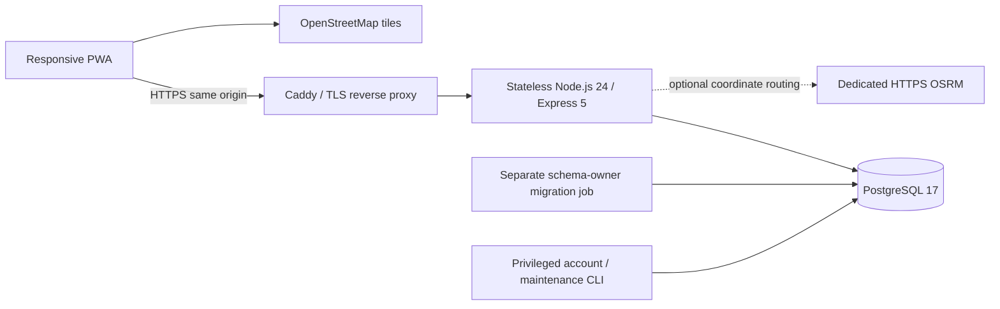
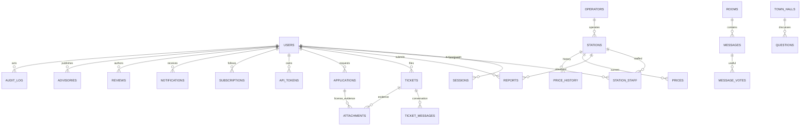

# Implemented architecture (v3)

This document supersedes the prototype localStorage model and aspirational microservice diagrams in documents 01–07.

## Boundaries

- PostgreSQL is the authoritative data store. No localStorage database or browser-supplied role/trust value is accepted. Sensitive writes require a live connection.
- All browser API writes require the configured Origin and custom request header. Authenticated writes additionally require a session-bound CSRF token. Session secrets are 256-bit random, hashed in PostgreSQL, HttpOnly/Secure (production)/SameSite=Strict cookies, absolute 12h expiry.
- Passwords use asynchronous scrypt (N=32768, r=8, p=1, random 128-bit salt, 64-byte key); passwords must be 12–128 characters. Login limits apply per IP and account; passwords and secrets are not request-logged.
- Integration credentials are 256-bit secrets, hashed at rest, tied to one account+station, expire after 90 days, and authorize **only** `PUT /api/v1/stations/:id/prices`. Every request checks current account and station assignment and revocation.
- API authorization is the per-user boundary. The runtime role has necessary table privileges, not schema ownership or RLS impersonation. PostgreSQL RLS is not claimed here. An API compromise with runtime credentials remains a privileged data-access incident.
- Database-backed fixed-window rate limits work across API replicas. They are not a DDoS protection layer; use the edge/WAF and monitor database load before high traffic.

## Persistent entities

Additional tables: `price_caps` (source and validity interval), `rate_limits`, `schema_migrations`. The SQL in `server/migrations/` defines all constraints and indexes. Prices are integer UGX per litre; coordinates are validated finite numbers; timestamps are timestamptz. Currency/fuel units are explicit in the UI. Region/district names remain a curated register, not an imported official geographical boundary dataset.

## Access matrix

| Capability | Public | Citizen | Assigned operator | Inspector | Analyst | Administrator |
|---|---|---|---|---|---|---|
| Directory, accepted prices, public messages/advisories | Yes | Yes | Yes | Yes | Yes | Yes |
| Submit reports/reviews, own cases, messages, follow stations | — | Yes | Yes | Yes | Yes | Yes |
| View another citizen's private case/evidence | — | — | — | Yes | — | Yes |
| Publish operator price | — | — | Assigned stations | — | — | Active stations |
| Own integration credentials | — | — | Assigned stations | — | — | Explicitly assigned stations |
| Review price reports / case decisions / hide abusive messages | — | — | — | Yes | — | Yes |
| Operational aggregates and audit read | — | — | — | Yes | Yes | Yes |
| Approve operator access, directory/caps/advisory management | — | — | — | — | — | Yes |
| Verify/suspend non-admin accounts | — | — | — | — | — | Yes |
| Provision inspector/analyst (create-only) | — | — | — | — | — | Yes (re-authenticated; workflow/CLI also available) |
| Explicitly assign/revoke an operator's station access | — | — | — | — | — | Yes |

Staff oversight is currently national. Add scoped district assignments before delegating regional-only case permissions. Admins cannot approve their own station applications, moderate their own reports, change their own role or suspend their own account. Administrator accounts and roles use the owner CLI; inspector/analyst provisioning is create-only through the re-authenticated admin UI or the protected workflow. Station assignments remain explicit even after an operator role is assigned.

## Publication workflow

1. Validate and persist a report with `(user_id,idempotency_key)` uniqueness. Acquire a station row lock before decisions/publication.
2. Compare with a rolling 48h baseline of **accepted non-demo history** and effective source-linked directives. An outlier remains `flagged` for human review; it is not automatically declared fraudulent.
3. Unverified accounts stay pending. Independently identity-verified citizens may form consensus: distinct accounts, 15min window, within 2.5% of the current observation (at most approximately 5% total spread). Operators and staff do not self-establish citizen consensus.
4. Otherwise inspector/admin decisions require reasons. A stale observation cannot overwrite a newer published price. A current price is unique by `(station_id,fuel)`.
5. Price, append history, audit and follower notifications commit together. Operator writes support an expected-update timestamp to detect stale screens. API integrations may omit it if intentionally publishing a fresh authoritative observation.

Identity verification is a real operational process, not an email-address count or a local trust score. The application records the decision; it does not itself verify a government ID or a telco identity. Do not mark test accounts as real verified citizens.

## Case workflow

`open → investigating → dispatched → resolved → closed`, with `investigating → resolved` allowed when no field dispatch is necessary. Assignment to an active inspector/admin, expected integer version and a shared reason are required for decisions. Row locks and versions prevent concurrent overwrites. Citizen/case-officer messages and up to three evidence attachments are private. First response and due time are server-owned. Overdue state is computed on reads, so it remains correct without a browser timer or background worker.

Notifications are actual in-app database records. There is no pretend SMS/WhatsApp success. Before adding outbound delivery, implement an outbox in the same transaction, an idempotent worker, retry/dead-letter handling, provider delivery status and contact-consent controls.

## Frontend and offline behavior

Hash navigation supports deep links and browser history; role-specific navigation reflects current server roles. Forms show loading/inline errors, preserve entries after failure, prevent duplicate clicks and use native dialog focus/escape behavior. Data is escaped before HTML interpolation; map popup content uses DOM text nodes. CSV exports neutralize spreadsheet formulas.

Leaflet is pinned through the lockfile and served locally. Script CSP permits only same-origin scripts; inline styles remain permitted for Leaflet's positioning. Third-party requests are limited to OSM map images and explicit external source/directions links. The service worker caches an allowlist of public shell assets, never API responses, uploaded evidence or unbounded map tiles. Offline data reads and writes fail visibly; no private local queue is retained.

## Deliberate operational limits

- Ordinary PostgreSQL coordinates with a latitude prefilter and Haversine calculation suit the initial station register. Adopt PostGIS/GiST and benchmark before large geospatial datasets; no nation-scale SLA is proven.
- Evidence uses private bounded bytea storage. Plan private object storage, malware scanning/quarantine, EXIF handling and retention at larger volumes; downloads are forced attachments, not inline trusted media.
- No automatic report-based promotion to an operator/government role, no simulated users, no fabricated historical chart interpolation, and no default legal directives.
- Full controller contact details, verified station register, national identity/provider connections, external notifications and jurisdiction-approved retention are deployment inputs.
